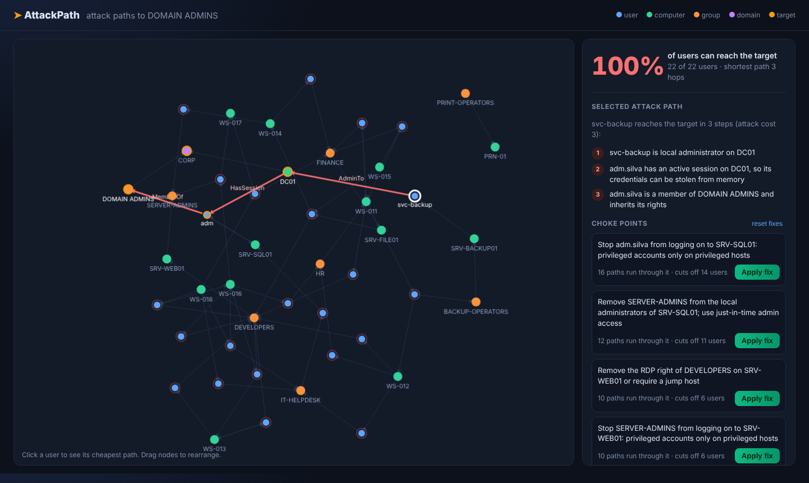
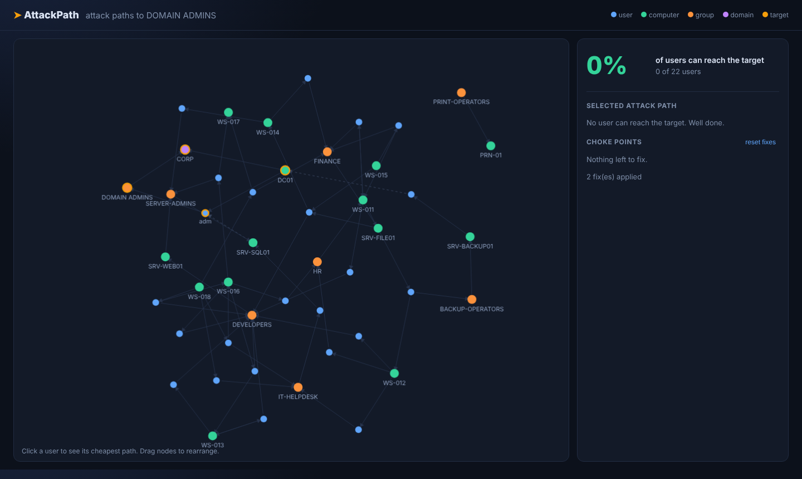

# AttackPath

Find the cheapest attack paths to **Domain Admins** in an Active Directory style graph, see them on an interactive map, and **fix the choke points live** to watch the risk fall. Single Go binary, zero dependencies, embedded web UI. Inspired by the attack graph approach popularised by BloodHound.

> Built with AI assistance (Claude) as part of a security portfolio. The environment is fictional and generated from a seed; no real directory is touched.

Before: every user has a path to Domain Admins.



After applying two fixes suggested by the tool: nobody does.



## Run it

```bash
go run ./cmd/attackpath                  # http://127.0.0.1:8090
go run ./cmd/attackpath -report          # terminal report of the top choke points
go run ./cmd/attackpath -seed 11         # a different generated environment
go run ./cmd/attackpath -graph my.json   # analyse your own graph (see format below)
```

Click a user to see its cheapest path narrated in plain English. Click **Apply fix** on a choke point and the whole analysis reruns: the percentage of users who can reach the target, the paths and the ranking all update.

## How it works

- **Graph**: nodes are users, computers, groups and the domain. Edges are attack primitives: `MemberOf`, `AdminTo`, `HasSession`, `CanRDP`, `GenericAll`, `ForceChangePassword`, `WriteDacl`, `AllowedToDelegate`, `DCSync`.
- **Cheapest path**: Dijkstra over per-primitive costs (membership is free because it is inherited, sessions and ACL abuse are cheap, RDP and delegation cost more). Ties break deterministically so results are reproducible.
- **Choke points**: every user's cheapest path is computed, edges are ranked by how many paths depend on them, and the **impact** of each fix is measured by actually removing the edge and recomputing. Membership edges are not listed because they are not directly actionable.
- **Remediation text**: each primitive maps to a concrete fix (remove from local admins, stop privileged logons on lower-tier hosts, drop an RDP right, remove a delegation, and so on).

## Custom graphs

```json
{
  "nodes": [{"id": "alice@corp", "name": "alice@corp", "type": "user"},
            {"id": "DOMAIN ADMINS@CORP", "name": "DOMAIN ADMINS@CORP", "type": "group", "high_value": true}],
  "edges": [{"from": "alice@corp", "to": "DOMAIN ADMINS@CORP", "type": "MemberOf"}]
}
```

Run with `-graph file.json -target "DOMAIN ADMINS@CORP"`. Loading is strict: unknown fields are rejected, and every validation problem (duplicate ids, unknown types, dangling or self-looping edges) is reported at once.

## Security notes

The server binds to loopback by default, sets a strict CSP (no inline script, no external origin), caps request bodies and validates edge IDs. The UI renders everything through `textContent`.

## Tests

`go test -race ./...` covers graph validation and strict loading, generator determinism and planted paths (including a true dead-end decoy), Dijkstra on cost versus hop count, zero-cost edges, cycles, unreachable targets, removed edges, tie-breaking, narration, choke point ordering, a remediation loop that must reach zero risk and never add paths, and every API status code. CI runs on Linux, macOS and Windows.

MIT licensed.
